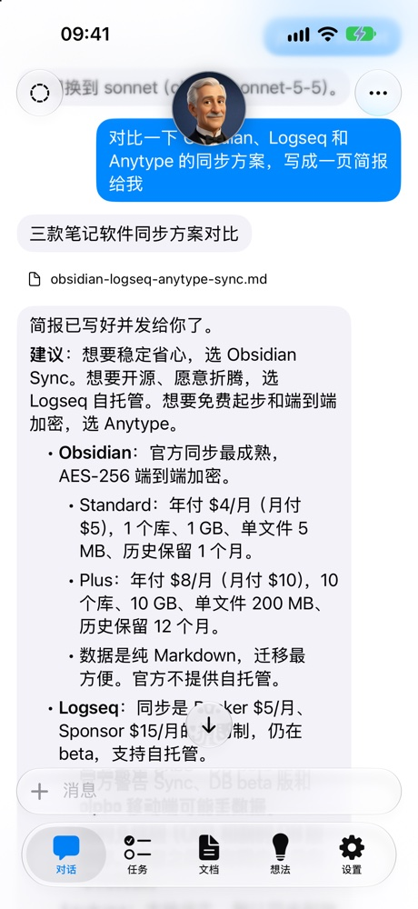
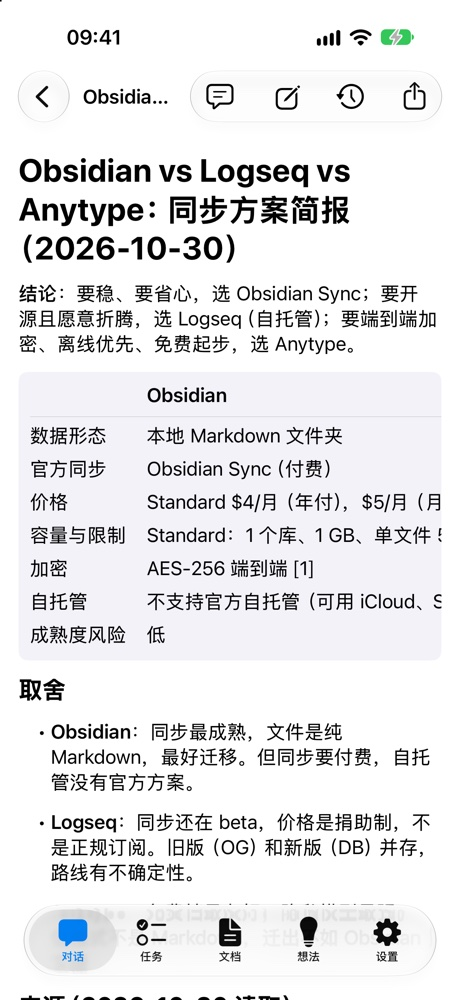
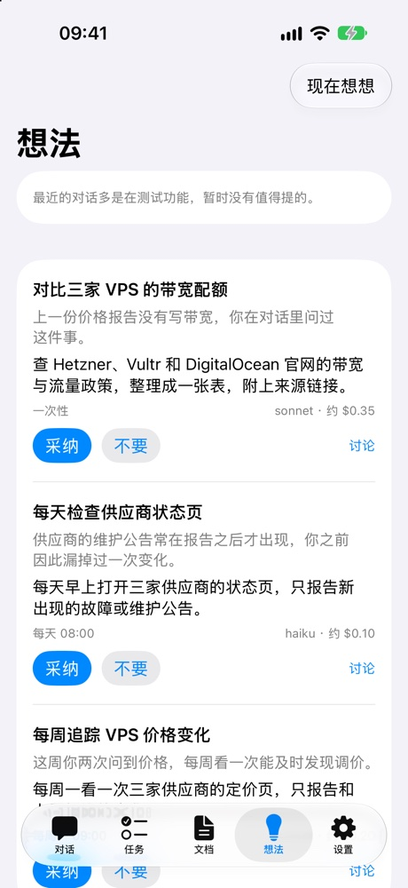
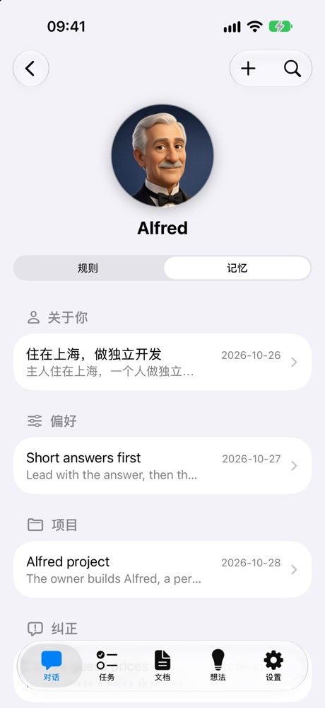

# Alfred

[](https://github.com/nervouna/alfred/actions/workflows/ci.yml)
[](https://github.com/nervouna/alfred/actions/workflows/ios.yml)
[](LICENSE)


A personal research assistant: web research, material collection and file organization, driven by the Claude Agent SDK. The owner talks to it through a native iOS app, which pairs with the workbench and reaches Alfred through it. Alfred itself listens on a local Unix socket only, so it opens no port.

| Chat | Documents | Ideas | Memory |
| --- | --- | --- | --- |
|  |  |  |  |

## Status

Alfred is a personal project, built for one owner and run by its author every day. It is open source so others can read, borrow from or run it, but it is not a hosted product: running your own takes a Linux host (or a Mac), an Anthropic API key, a domain behind Cloudflare Access for the workbench, and an Apple developer account to install the app. The app's interface is in Chinese. Expect things to change without notice; there are no releases with upgrade paths yet.

## How it is built

Most of the code is written by Claude Code agents: each issue is a spec, an implementer delivers one pull request per issue, and an orchestrator reviews, re-runs the acceptance commands and merges. `CLAUDE.md` holds the rules they follow, and `docs/` the design notes they keep up to date. See [CONTRIBUTING.md](CONTRIBUTING.md) to report a bug or send a fix, and [SECURITY.md](SECURITY.md) for security problems.

## Requirements

- Node.js 24+ (runs TypeScript directly, no build step)
- The Alfred app (`ios/`), paired with the workbench ([docs/workbench.md](docs/workbench.md)), to talk to it
- An Anthropic API key in `ALFRED_ANTHROPIC_API_KEY`. Give Alfred a key of its own, in a Console workspace with a spend limit, so a leaked key costs at most that limit and can be revoked without touching anything else
- Optional, for image generation: the [`mmx`](https://www.npmjs.com/package/mmx-cli) CLI with a MiniMax Token Plan key in `~/.mmx/config.json` or `$MMX_CONFIG_DIR/config.json` (check with `mmx quota show`)

## Usage

```bash
npm install
npm run setup:pdf  # one-time: download Chrome Headless Shell (~99 MB) for PDF rendering
npm start          # run the assistant: the agent behind the command API, and memory scans
npm run status     # whether it runs: its API socket and its last heartbeat
npm run smoke -- --model haiku "prompt"   # run one prompt through the agent locally, without the app
```

`npm start` needs the command API, the only way in, and refuses to start with `ALFRED_API_SOCKET=off`. The owner is whoever holds a paired device; Alfred has no other login. Do not start a second `npm start` against the same state dir while Alfred runs: it would take over the command socket and run tasks on the same sessions.

## Run in a container (Linux)

`Containerfile` builds an image with Node 24, Chrome Headless Shell, CJK fonts and the `mmx` CLI. `deploy/alfred.container` runs it as a rootless podman Quadlet: the state dir and workspace are bind mounts under `~/data/`, the API key and the mmx config are podman secrets, and logs go to the journal. Use a dedicated, unprivileged user with lingering enabled (`loginctl enable-linger <user>`), and run everything below as that user:

```bash
git clone https://github.com/nervouna/alfred ~/alfred && cd ~/alfred
podman build -t localhost/alfred:latest .
mkdir -p ~/data/state ~/data/workspace
read -rs KEY && printf %s "$KEY" | podman secret create alfred_anthropic_api_key - && unset KEY   # paste the key, Enter
podman secret create alfred_mmx_config /path/to/mmx/config.json
install -Dm644 deploy/alfred.container ~/.config/containers/systemd/alfred.container
systemctl --user daemon-reload && systemctl --user start alfred
```

- Then set up the workbench and pair the app ([docs/workbench.md](docs/workbench.md)). Update with `deploy/update.sh`, logs with `journalctl --user -u alfred -f`; the container restarts 30 s after any exit and starts at boot.
- Keep the installed `alfred.container` identical to the repo's: `update.sh` stops when they differ. Settings for your host go in a Quadlet drop-in, which podman merges into the unit, and need `update.sh --restart` to take effect:

  ```bash
  mkdir -p ~/.config/containers/systemd/alfred.container.d
  cat > ~/.config/containers/systemd/alfred.container.d/host.conf <<'EOF'
  [Container]
  # Your time zone: a drop-in's TZ replaces the Quadlet's default.
  Environment=TZ=Europe/Berlin
  EOF
  systemctl --user daemon-reload
  ```

## Talking to Alfred

Send a task as text. Photos and files go with a message (the app uploads them to `~/Alfred/inbox/<date>/` first); files sent without text are attached to the next text message. Replies stream in as they are written. Long results arrive as Markdown files, a report with charts as an HTML file the app opens in a sandbox, a PDF only when you ask for one. A delivered file is a document with a version per delivery, open to annotations ([docs/documents.md](docs/documents.md)).

One task runs at a time, and a message sent during it steers it ([docs/api.md](docs/api.md)). Slash commands:

| Command | Effect |
| --- | --- |
| `/new` | start a new session (drops the conversation context; `/resume` brings it back) |
| `/resume` | switch back to the previous session for the next task; send it again to switch back |
| `/stop [run id]` | interrupt the turn the agent is on; with a run id, stop only that background subagent, task run or revision run, live or queued |
| `/model [sonnet\|opus\|haiku]` | show or switch the model; default `sonnet` |
| `/memory` | list long-term memories |
| `/status` | model, session age, spend against the daily cap, current and queued runs, active tasks with their next run |
| `/help` | command list |

The app's chat menu offers `/new`, `/resume`, `/model`, `/status` and `/memory` as items, each sending the same text.

Alfred can also ask a question mid-run, with a few options, instead of guessing. Recurring work is set up as tasks ([docs/tasks.md](docs/tasks.md)), and Alfred suggests tasks of its own as ideas ([docs/ideas.md](docs/ideas.md)).

## Command API

Everything the app does goes through one local API on a Unix socket (`ALFRED_API_SOCKET`, mode 0600); the workbench forwards the app's requests to it. `POST /commands` takes one command as JSON, `POST /uploads?name=` saves a file into the inbox, `GET /events` streams the event log and live events, `GET /health` answers `{"ok": true, "lastEventId": <n>}`. The contract is `src/api/schema.ts`, tested against `fixtures/api/` on both the Node and the Swift side; semantics are in [docs/api.md](docs/api.md).

```bash
node src/cli.ts api send "text"          # also: upload <file>, stop <run id>, events [--after <id>] [--follow]
curl --unix-socket "$STATE_DIR/api/alfred.sock" -N http://localhost/events
```

## Configuration

A malformed value of a setting that `src/agent/config.ts` validates stops Alfred at startup with a message naming the variable.

The variables are defaults. The app can override `ALFRED_MAX_BUDGET_USD`, `ALFRED_DAILY_BUDGET_USD`, `ALFRED_SESSION_IDLE_HOURS`, `ALFRED_COMPACT_TOKENS`, `ALFRED_MEMORY_SCAN_MINUTES`, `ALFRED_MEMORY_SCAN_BUDGET_USD` and `ALFRED_IDEAS_AT` while Alfred runs, and the model with `/model`; an override beats the environment, and the environment beats the built-in default.

| Variable | Default | Purpose |
| --- | --- | --- |
| `ALFRED_ANTHROPIC_API_KEY` | required | Anthropic API key; inherited `ANTHROPIC_*` variables are ignored |
| `ALFRED_LOG` | `info` | `debug` logs the agent's stderr |
| `ALFRED_MAX_BUDGET_USD` | `10` | spend cap per query, follow-ups and background subagents included |
| `ALFRED_DAILY_BUDGET_USD` | `20` | spend per day (owner's time zone), scheduled runs and idea generations included; once reached, nothing new starts |
| `ALFRED_SESSION_IDLE_HOURS` | `4` | idle hours before the next task starts a new session; `0` disables |
| `ALFRED_COMPACT_TOKENS` | `100000` | context size at which Claude Code compacts; `0` keeps its own window, else at least 20000 |
| `ALFRED_MMX_BIN` | `$CLAUDE_CONFIG_DIR/skills/mmx/bin/mmx` (`~/.claude/…` when unset) | `mmx` executable for `generate_image` |
| `ALFRED_MEMORY_SCAN_MINUTES` | `60` | interval between memory scans; `0` turns them off (`npm run memory-scan` still works) |
| `ALFRED_MEMORY_SCAN_BUDGET_USD` | `0.1` | spend cap for one scan |
| `ALFRED_IDEAS_AT` | `08:00` | time of the daily idea generation (`HH:MM`); empty turns it off |
| `ALFRED_API_SOCKET` | `$STATE_DIR/api/alfred.sock` | the command API's socket; `off` disables the API |
| `ALFRED_WORKBENCH` | off | `on` when a workbench is deployed: the agent is told HTML reports can be read there |
| `ALFRED_WORKBENCH_URL` | none | the workbench's https origin: card links in replies (implies `ALFRED_WORKBENCH=on`) and the server in the pairing QR code; `http://` only on loopback |
| `ALFRED_WORKBENCH_LISTEN` | `127.0.0.1:8787` | the workbench's TCP listener (`host:port`, or `off`) |
| `ALFRED_WORKBENCH_SOCKET` | none | the workbench's Unix socket, the SSH-tunnel fallback |
| `ALFRED_WORKBENCH_STATE` | `$ALFRED_STATE_DIR/app` | the directory of `devices.json` |
| `ALFRED_WORKBENCH_OWNER_EMAIL`, `CF_ACCESS_TEAM_DOMAIN`, `CF_ACCESS_AUD` | none | the one email allowed in, the Access team domain, the application's AUD tag |
| `CF_ACCESS_SERVICE_CLIENT_ID`, `CF_ACCESS_SERVICE_CLIENT_SECRET` | none | the app's Access service token; `pair` puts both in the QR code |
| `ALFRED_APNS_KEY_FILE`, `ALFRED_APNS_KEY_ID`, `ALFRED_APNS_TEAM_ID`, `ALFRED_APNS_TOPIC` | none | push: the `.p8` key file, its id, the Apple team id, the app's bundle id; with any one missing push is off and the log names it |

## State and files

| Path | Content |
| --- | --- |
| `$XDG_STATE_HOME/alfred/` (default `~/.local/state/alfred/`, override with `ALFRED_STATE_DIR`; `…` below) | `agent-state.json` (the owner's record: sessions, model, spend, per-model unit prices, deliveries since the last message), `settings.json` (the owner's overrides of the settings, nothing else), `memory-scan.json`, `ideas-schedule.json`, `memory.lock`, `events/events.jsonl` (the append-only event log, kept for good), `api/alfred.sock`; files are mode 600 |
| `…/workbench/` | what the workbench reads: `runs.jsonl`, `runs/<id>.json` (kept 30 days), `status.json` (heartbeat), `alfred.log` (rotated at 5 MB), and `tasks.json`, `ideas.json`, `documents.json`, `settings.json` (the effective settings, which the workbench cannot work out for itself), each written only by its store, and `trash.json` (the time the sweep first saw each file in `.trash/`), written only by the sweep |
| `…/workbench/versions.git/` | the workspace's git history (mode 700), a git dir outside the workspace, so the workspace holds no `.git` ([docs/documents.md](docs/documents.md)) |
| `…/claude/` | isolated Claude Code config dir: session transcripts, used for resume |
| `…/workspace-plugin/` | the `workspace` skills plugin, recreated at startup |
| `…/{account,sync,context-tokens}.json` | what the retired WeChat bot kept; nothing reads them |
| `$ALFRED_WORKBENCH_STATE` (default `…/app/`) | `devices.json` (each device with the SHA-256 of its token, never the token, and its push registration), `push-cursor.json`; directory mode 700, file 600 |
| `~/Alfred/` (override with `ALFRED_WORKSPACE`) | the workspace: `ALFRED.md`, `inbox/`, `reports/` (a task's in `reports/tasks/<task id>/`), `notes/`, `images/`, `memory/`, `skills/`, `.trash/` (emptied: a file is removed 30 days after Alfred first sees it there) |
| `$XDG_CACHE_HOME/alfred/ms-playwright/` | Chrome Headless Shell for PDF rendering |

## Layout

```
src/cli.ts          run | status | setup-pdf | pdf | memory-scan | workbench | apns-test | pair | devices | api
src/channels.ts     the app channel boundary and the recording of every message as an event
src/events.ts       the append-only event log clients read
src/runs.ts         run ids and records, the heartbeat the workbench reads
src/api/            the client API: schema, the Unix-socket server, the client behind `api`
src/agent/          the Agent SDK handler (intake queue, routing, stop), questions, guard, rules, skills, tools, sessions, memory
src/documents/      workspace versions in git, the document store, the document commands
src/ideas/          the idea store, its commands, archiving, generation and its daily schedule
src/settings/       the settings store (the owner's overrides over the environment) and its command
src/tasks/          schedule arithmetic, the task store, the task commands
src/workbench/      the read-only workbench: server, Access check, pages, pairing, forwarding to the API, push
plugin/             the baked skills plugin `alfred`
scripts/            app-dev, agent-smoke, handler-smoke, local-stack
deploy/             Quadlet units and update.sh for the container host
fixtures/api/       the client contract's examples
ios/                the native client (ios/README.md)
```

## Development

```bash
npm run check                       # type-check
npm test                            # unit tests
node scripts/handler-smoke.ts api   # the real handler behind the command API; scenarios are in the script's header
node scripts/app-dev.ts --port 8787 # a local Alfred for the app in the simulator
```

- `npm run smoke` and the handler scenarios call the real model and cost money. Without scratch `ALFRED_WORKSPACE` and `ALFRED_STATE_DIR` they use the real workspace and agent config dir, and so does `npm run memory-scan`. Flags are in each script's header.
- `scripts/app-dev.ts` runs the real handler behind the command API and the workbench on `127.0.0.1` without the Access check, pairs a device named `simulator` and prints the pairing. It requires scratch `ALFRED_STATE_DIR` and `ALFRED_WORKSPACE` and `ALFRED_ANTHROPIC_API_KEY`.
- The iOS client builds with Xcode 27 and XcodeGen; `ios/README.md` covers the build, the tests and the phone install.

## Docs

[api](docs/api.md) (the app channel, command API, event stream, steering and stopping), [workbench](docs/workbench.md) (pages, device pairing, push, host setup), [agent](docs/agent.md) (sessions, memory, `ALFRED.md` rules, skills, sandbox, spend), [subagents](docs/subagents.md), [tasks](docs/tasks.md), [documents](docs/documents.md), [ideas](docs/ideas.md).

## License

MIT, see `LICENSE`.
